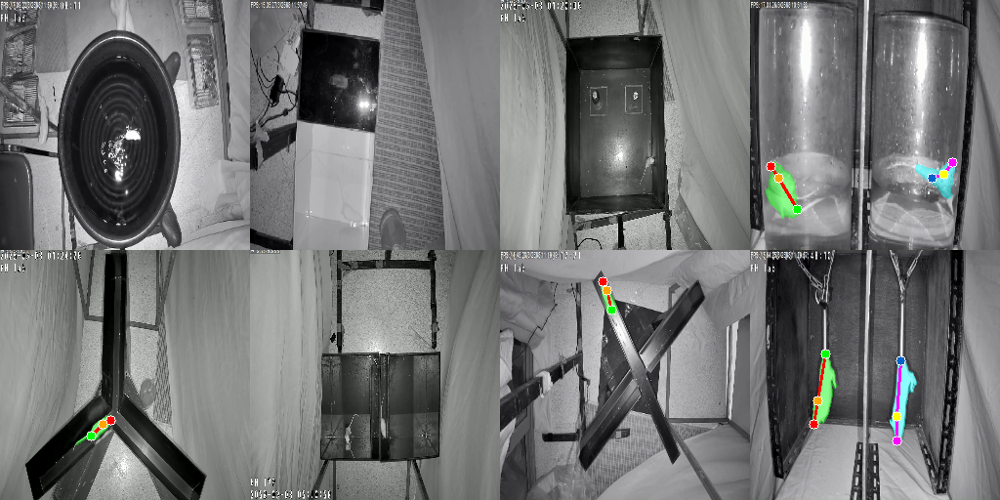
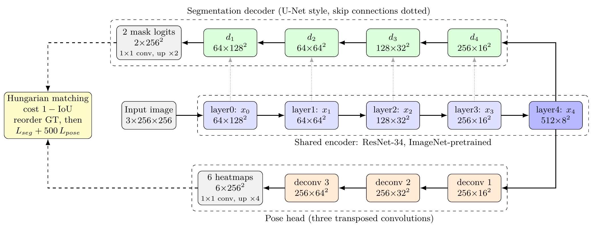

# HybridMTLNet: Box-Free Instance Segmentation and Pose Estimation of Laboratory Mice

A single network that outputs a **mask for every mouse** and its **keypoints** (nose, shoulder,
tail base) **in one forward pass**, for behavioural studies of laboratory mice.

> **Paper:** *A Unified Box-Free Network for Joint Instance Segmentation and Pose Estimation of
> Laboratory Mice.* T. Sripanya, P. Padungweang, Y. Chulikhit, C. Dechsupa, K. Sunat.
> International Conference on Data Science and Artificial Intelligence (DSAI 2026),
> Springer CCIS — accepted, in press.



## Why

Behavioural pharmacology needs both outputs from the same frame: masks give body area, shape and
contact between animals; keypoints give heading and body axis. The tools rodent laboratories use
predict pose only, so masks need a second model and every image is processed twice.
Detection-based joint models such as Mask R-CNN crop each animal and predict its mask on a
28 × 28 grid, which blurs thin parts such as the tail.

HybridMTLNet shares one encoder between both tasks and predicts masks at full resolution, with
no bounding boxes or region crops.

## Architecture



- **Shared encoder:** ImageNet-pretrained ResNet-34 (21.3 M parameters).
- **Segmentation decoder:** U-Net-style, with skip connections; two mask channels, one per mouse,
  at 256 × 256 (3.2 M).
- **Pose head:** three transposed convolutions; six heatmaps, three keypoints for each of two
  mice (4.2 M).
- **Order-invariant matching:** the two output slots have no fixed order, so the ground truth is
  matched to them with the Hungarian algorithm on mask IoU at every training step (with two
  slots this is permutation-invariant training, as in Yu et al. 2017 and DETR).
- **Loss:** BCE + Dice for masks, plus 500 × MSE for heatmaps.

**28.7 M parameters in total**, one forward pass for both outputs.

## Results

Test set of 371 images from 8 behavioural tests (3,710 annotated images in total), 256 × 256,
mean ± std over 3 seeds unless marked. As reported in the paper:

| Model | Task | mIoU | PCK@0.05 |
|---|---|:-:|:-:|
| **HybridMTLNet (ours)** | **masks + keypoints** | **0.8083 ± 0.0012** | **0.9605 ± 0.0027** |
| Mask R-CNN (single run) | masks | 0.7854 | — |
| YOLO26m-Seg | masks | 0.5497 ± 0.0181 | — |
| YOLO26m-Pose | keypoints | — | 0.8823 ± 0.0053 |

Ablation on the same architecture:

| Training | mIoU | PCK@0.05 |
|---|:-:|:-:|
| Segmentation only | 0.8089 ± 0.0009 | — |
| Pose only | — | 0.9719 ± 0.0018 |
| Joint (ours) | 0.8083 ± 0.0012 | 0.9605 ± 0.0027 |

Joint training keeps segmentation accuracy and costs 0.0114 PCK against the pose-only network: a
small negative transfer that the paper reports rather than hides. The contribution is a single
network for both outputs, not a multi-task accuracy gain.

**Re-evaluation after publication.** For the M.Sc. thesis the baselines are being re-run on a
stricter common footing (tuned inference settings, one mask threshold, three seeds each, and a
joint Mask R-CNN with mask and keypoint heads). The margins over the published baselines narrow
under that protocol; the updated comparison will be reported in the thesis.

## Usage

```bash
python -m venv venv
# Windows: venv\Scripts\activate    Linux/macOS: source venv/bin/activate
pip install torch torchvision --index-url https://download.pytorch.org/whl/cu128   # RTX 50-series
pip install -r requirements.txt

python main.py prepare            # Label Studio export -> data/dataset.json
python main.py train              # joint training, seg:pose = 1:500
python main.py eval --weights models/checkpoints/model_best.pth
python main.py benchmark          # parameters, FLOPs and latency
python app/run_multiseed.py --seeds 42 43 44   # seg-only / pose-only / joint ablation
```

The dataset (`data/`) and trained weights (`models/`) are not included in this repository.

## Repository layout

```
config.py                 data, model and training configuration
main.py                   prepare / train / eval / experiment / benchmark
src/models/mtl_net.py     HybridMTLNet
src/training/trainer.py   training loop, Hungarian matching, loss
src/evaluation/           mIoU, PCK and the efficiency benchmark
baselines/                Mask R-CNN and YOLO baselines
app/                      multi-seed runs, sweeps, figures
paper/                    LaTeX source of the paper
```

## Citation

```bibtex
@inproceedings{sripanya2026hybridmtlnet,
  title     = {A Unified Box-Free Network for Joint Instance Segmentation and Pose Estimation of Laboratory Mice},
  author    = {Sripanya, Thanabat and Padungweang, Praisan and Chulikhit, Yaowared and Dechsupa, Chanon and Sunat, Khamron},
  booktitle = {International Conference on Data Science and Artificial Intelligence (DSAI 2026)},
  series    = {Communications in Computer and Information Science},
  publisher = {Springer},
  year      = {2026},
  note      = {Accepted, in press}
}
```

## Acknowledgements

College of Computing and Faculty of Pharmaceutical Sciences, Khon Kaen University.
